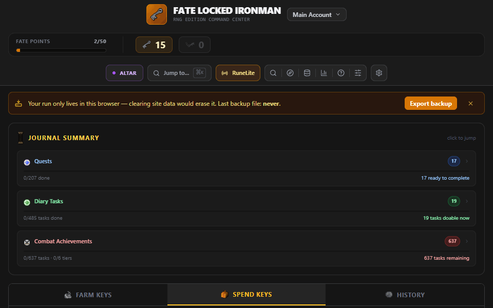
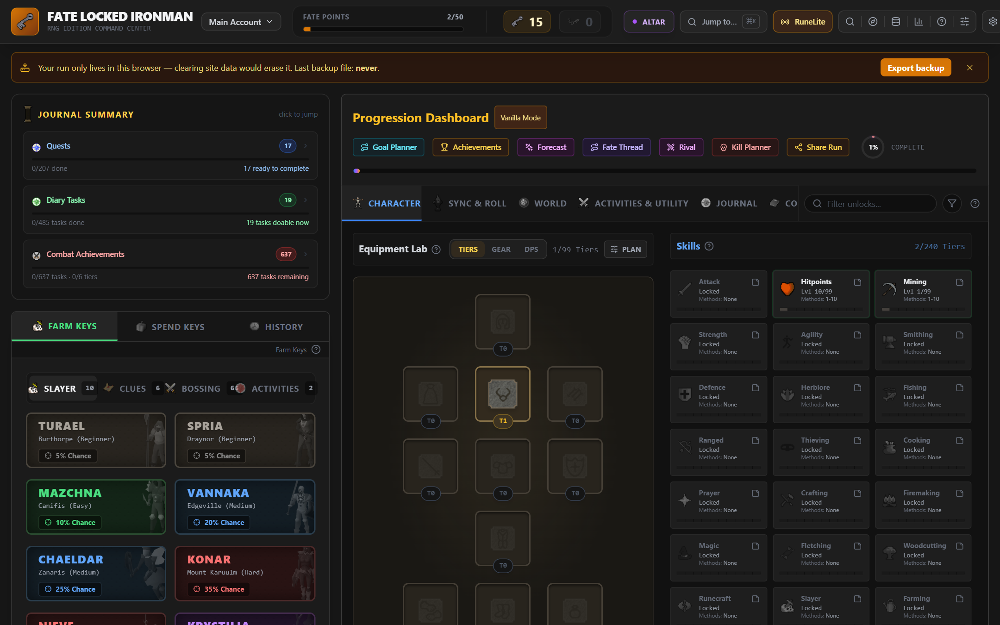
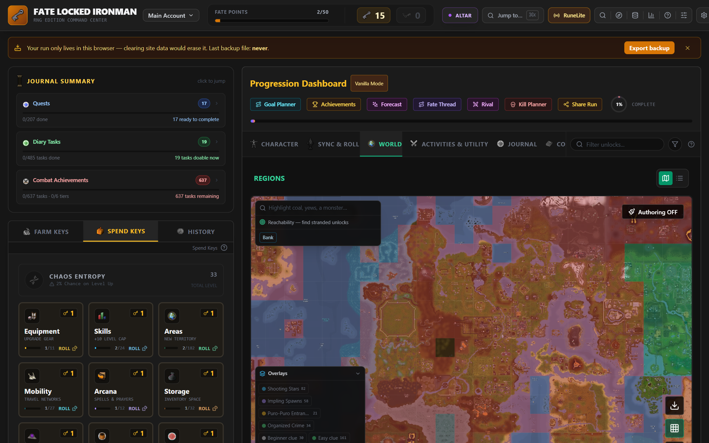
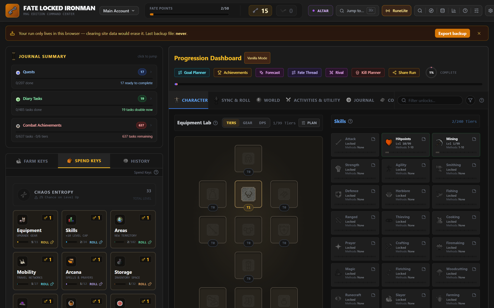
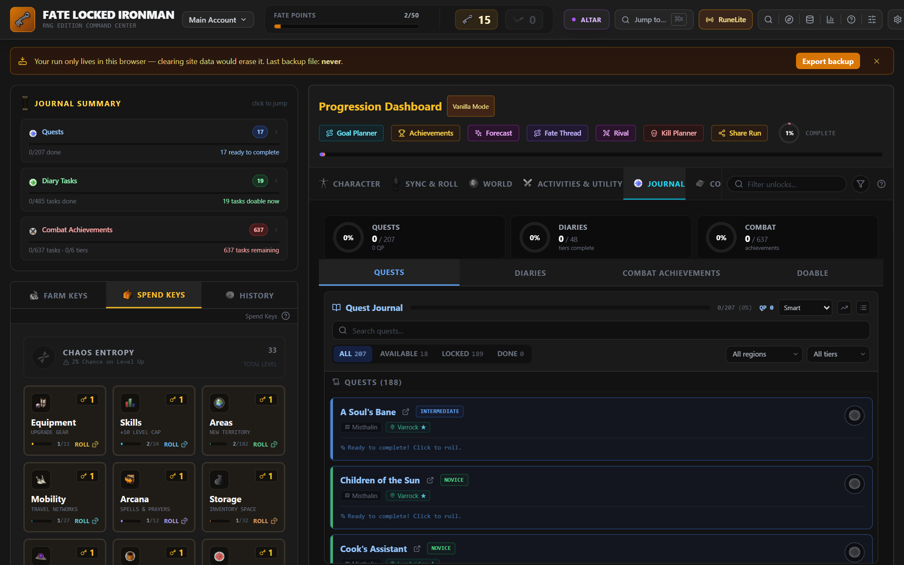

# Fate Locked Ironman

A companion tracker for the **Fate Locked Ironman** challenge mode in Old School RuneScape — a restriction run where your account starts with *everything* locked, and Fate decides what you unlock.

**Live app:** https://nubles.github.io/OSRS-Fate-Locked/



## The concept

You begin as a fresh Ironman with 3 Keys and nearly everything locked: no gear slots, no skills except Hitpoints (always fully open), no transport, no banks and no shops. In Vanilla you can go anywhere in Misthalin from the start; in Chunked you start in one chunk of Lumbridge. To progress you:

1. **Farm Keys** — complete in-game tasks (Slayer tasks, Clue scrolls, quests, diaries, levels) and roll against their drop rate.
2. **Spend Keys** — cash Keys in on a content table (Skills, Equipment, Regions, Bosses, Minigames…) to unlock a random entry.
3. **Snowball** — each unlock opens up new tasks, which earn more Keys.

Bad luck is cushioned by **Fate Points** (a pity timer) and the **Void Altar**, where Fate Points can be spent on rituals. Rare **Omni-Keys** let you pick an unlock directly; **Chaos Keys** unlock from any table at random.

## Screenshots

| | |
|---|---|
|  |  |
| *Farm Keys & the Character dashboard* | *Spend Keys & the world region map* |
|  |  |
| *Unlock tables & the Equipment Lab* | *The Journal: quests, diaries & combat achievements* |

## Features

- **Rules window (the Codex)** — tabs for Core Rules, the Key Economy (every way to earn and spend Keys), Game Modes, RNG & Drop Rates, the Void Altar, Unlock Systems, Equipment Tiers and Storage. The tables and rates come from typed sources (mostly `config/economy.ts`) that consistency tests pin to the engine; the prose around them is written by hand in `components/ReferenceModal.tsx`.
- **Farm Keys** — four tabs of roll cards (Slayer, Clues, Bossing and Activities) with animated rolls, plus pointers to skill, journal and collection-log rolling.
- **Spend Keys** — gacha-style unlock tables with reveal animations.
- **Progression Dashboard** — Character (equipment tiers, skills), World (interactive region map), Activities & Utility (bosses, minigames, guilds… with region tags), Journal (quests, diaries, combat achievements), and Collection Log.
- **Game Modes** — Vanilla (the supported ruleset) and the experimental Chunked mode, where land unlocks one map chunk at a time. The mode is chosen at the start of a run and locked in permanently. Runs started under the retired Casual, Hardcore, Region Rush, Xtreme Start and Custom modes keep their original rules.
- **Region modifiers** — legacy Region Rush runs keep their per-continent passive bonuses.
- **Region map authoring** — paint custom region/chunk layouts, export/import as JSON.
- **Run check** — a hash chain over the run history, a deterministic run ID, and a replay that checks rolls against their chances and adds the history up against the saved Keys, Fate and unlocks. It is self-reported and checked on the player's device: the chain is unkeyed and the run bundle is not signed, so it catches mistakes and casual edits, not a determined forger.
- **Shareable run card & timelapse** — generate an image of your run, or play its history back as a narrated timelapse.
- **Profiles** — multiple independent runs in one browser.
- **RuneLite companion plugin** — imports the active profile, marks locked content in-game, explains the current chunk, and keeps supported gameplay detections in a local history.

## Tech stack

React 18 · TypeScript · Vite · Tailwind CSS · Recharts · Vitest

## Run locally

Use Node.js 22.13 or later in the 22.x line to match CI.

```bash
npm install
npm run dev
```

The app runs at `http://localhost:5173`. No API keys are needed.

A run is stored in the browser (`localStorage`, with a recovery copy in
IndexedDB). Some features talk to the Fate Locked relay in
`workers/fate-relay/`, each only when you use it: RuneLite pairing
([docs/online-relay.md](./docs/online-relay.md)), the encrypted online backup
([docs/online-backup.md](./docs/online-backup.md)), Discord sharing
([docs/shared-progress.md](./docs/shared-progress.md)), the stream overlay,
and the Clan tab of the OSRS layout's chatbox, which shows other players'
unlocks while it is open (Settings > Clan broadcasts, on by default). Production builds
also send thin crash reports to the relay (`utils/errorReport.ts`): the build,
the error and the page path, never save data.

Fate Analytics can export a voluntary local aggregate for the
[key-economy evidence protocol](./docs/key-economy-evidence.md). Nothing is
uploaded automatically.

## Other scripts

```bash
npm run build     # production build to dist/
npm run preview   # preview the production build
npm test          # run the test suite (Vitest)
npm run test:watch
```

## Deployment

The app deploys to **GitHub Pages** automatically via `.github/workflows/deploy.yml` on every push to `main` — it installs dependencies, runs the tests, builds, and publishes. The build's base path is derived from the repository name, so it works regardless of what the repo is called.

To enable it on a fresh fork: **Settings → Pages → Build and deployment → Source → "GitHub Actions"**.

## Maintainer docs

- [`docs/RESOURCE_ENGINE.md`](./docs/RESOURCE_ENGINE.md) — the Resource Engine: data shape, the supply-chain analyzer, the three wiki-sourced generator scripts (`scripts/buildCraftables.mjs`, `scripts/buildPotions.mjs`, `scripts/buildSourceEnrichment.ts`), the enrichment merge pattern, the integrity-test contract, and the workflow for adding curated items.

## RuneLite plugin connection

The companion [RuneLite plugin](https://github.com/Nubles/OSRS-Fate-Locked-Runelite)
renders the active profile's tracker rules in-game and warns before locked
actions. The standalone repository exclusively owns plugin source, builds,
releases, and Plugin Hub review.

The player-facing [RuneLite Plugin Guide](https://nubles.github.io/OSRS-Fate-Locked/?open=runelite-guide)
explains installation, connection, every panel section and setting, privacy,
overlays, and troubleshooting. It follows the plugin's main branch (through
`contracts/golden-bundles/runelite-wording.json`), so until the next Plugin
Hub release it can describe settings the Hub build does not have yet.

Pairing is one-way. RuneLite's **Connect tracker** (or **Re-pair tracker…**
while a pairing works) makes a random pairing code and opens the tracker
with it in the URL fragment. The browser then publishes an app-authored v4
profile with `POST /r/<code>`, and the plugin retrieves and validates it
with `GET /r/<code>`. It does not upload gameplay, account, event,
acknowledgement, suggestion, or heartbeat data.

The browser cannot know whether RuneLite imported the profile because the
current Plugin Hub candidate sends no receipt. “Profile sent” therefore
describes a successful browser publish, not a live connection. See
[the relay protocol](./docs/online-relay.md) for the current boundary.

## Disclaimer

Old School RuneScape and its assets are © Jagex Ltd. This is an unofficial fan-made tool and is not affiliated with Jagex.
